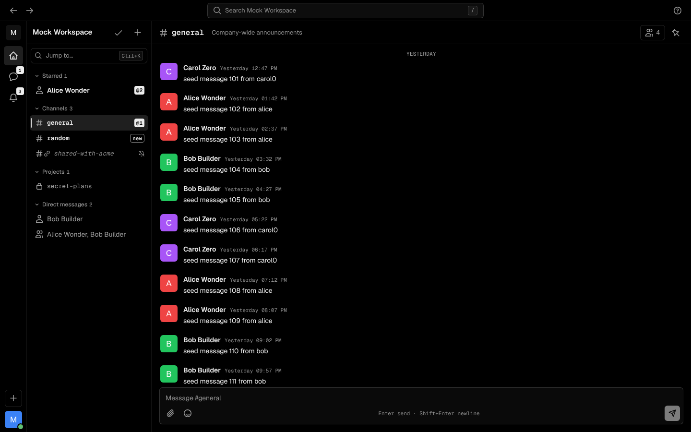
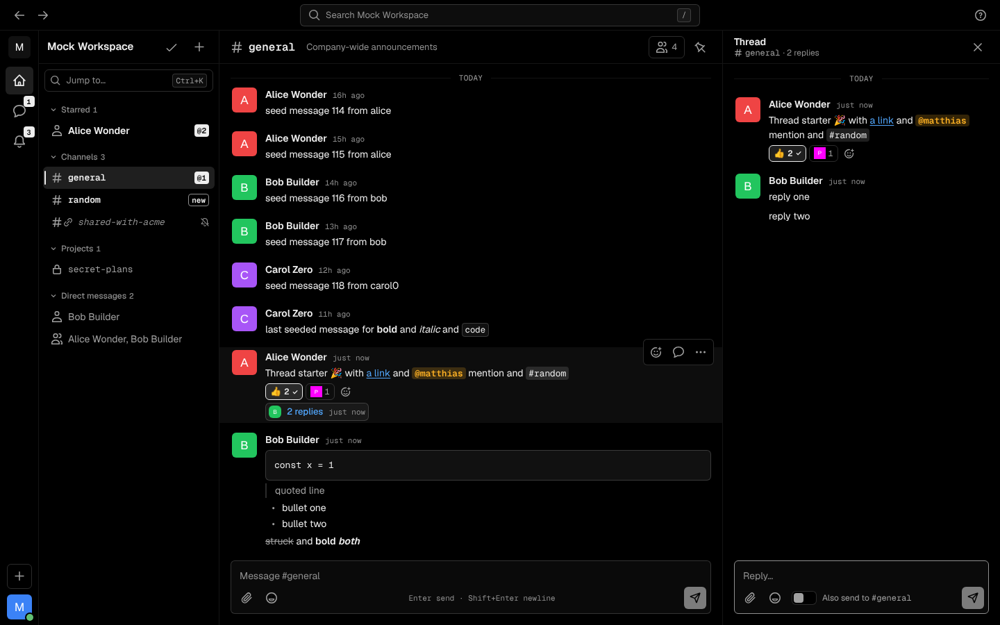
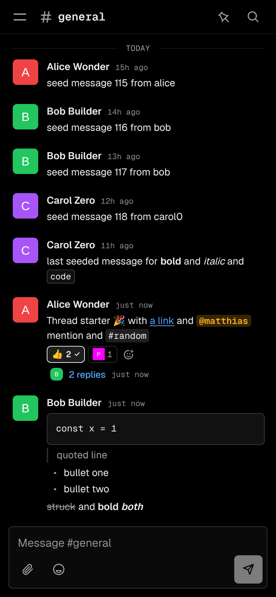
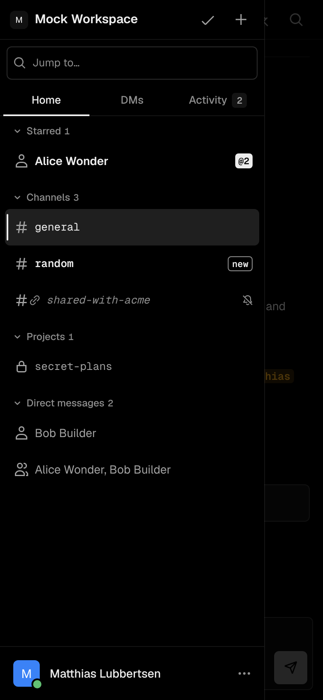

# Sleck

An alternative Slack client for **your own** Slack account: every conversation you're in, realtime over WebSockets, threads, reactions, emoji, search, uploads, keyboard-first, in a dark Geist-style UI that works on a phone.

|  |  |
|---|---|
|  |  |
|  |  |

More: [emoji picker](docs/screenshots/05-emoji-picker-desktop.png) · [@mention autocomplete](docs/screenshots/06-mention-autocomplete-desktop.png) · [quick switcher](docs/screenshots/07-quick-switcher-desktop.png) · [profile menu](docs/screenshots/08-profile-menu-desktop.png) · [search](docs/screenshots/11-search-desktop.png) · [message actions](docs/screenshots/04-message-actions-desktop.png) · [tablet](docs/screenshots/13-channel-tablet.png) · [phone: thread](docs/screenshots/17-thread-phone.png), [actions](docs/screenshots/18-message-actions-phone.png), [search](docs/screenshots/19-search-phone.png), [login](docs/screenshots/20-login-phone.png). The screenshots show a mock workspace (`scripts/mock-slack.ts`), not real data.

- **Frontend:** React + Vite + TypeScript, Tailwind v4, Radix-based components styled to Geist conventions, Geist Sans / Geist Mono, Geist icons.
- **Backend:** Node 22 + Hono. Keeps your Slack credentials server-side (AES-256-GCM in SQLite), proxies the Slack Web API, holds the realtime connection to Slack and relays it to your browser over a WebSocket.
- **Single user, workspace-aware:** everything is keyed by `(team_id, user_id)`, so multi-workspace can be added later.

```
server/    Hono backend
  index.ts       wiring, CSP/security headers, static files, WebSocket upgrade
  auth.ts        sign-in (OAuth + browser-session import), session + CSRF middleware
  api.ts         /api/* (allow-listed Slack calls, uploads, file proxy)
  ws.ts          browser <-> server WebSocket (/api/ws): events down, `send` up (acked)
  rtm.ts         Slack realtime socket for browser sessions (reconnect, resync)
  events.ts      Events API receiver for OAuth installs; dispatch.ts shared event pipeline
  slack.ts       Slack client: queue, 429/Retry-After, TTL cache; convs.ts unread tracking
  db.ts crypto.ts signature.ts hub.ts config.ts
web/src/   React app (components/, lib/store.ts = client state, lib/socket.ts = WebSocket client)
shared/    types shared by both
scripts/   grab-slack-session, mock Slack, e2e / a11y / screenshots
```

## Two ways to sign in

| | **Browser session** (recommended) | **Official OAuth app** |
|---|---|---|
| What it uses | the same `xoxc` token + `d` cookie Slack's own web client uses | a Slack app you create, user scopes only |
| Realtime | Slack's realtime websocket (RTM), no setup | Events API: needs a public HTTPS URL and event subscriptions |
| Unread / mentions | exact, from Slack (`client.counts`) | derived in the background (slow on big workspaces) |
| Sidebar sections & mute state | Slack's own (`users.channelSections.list`, `users.prefs.get`) | local only |
| Rate limits | as the web client | stricter if the app is distributed |
| Terms of service | **grey area**: it is an undocumented API; Slack may rate-limit or block it | fully supported |

Both work at the same time on one deployment; the login screen shows what is configured.

> **Use a browser session only for your own account, on your own server.** The blob you paste is your live Slack login. Sleck stores it encrypted and never sends it to the browser, but Slack's terms don't bless this API, so there is some risk to your account. The undocumented methods used come from the community catalogue at <https://vs.izie.top/redocumented> (`rtm.connect`, `client.counts`, `users.channelSections.list`, `users.prefs.get`). That catalogue marks some of them live-verified; **none of this has been run against a real workspace by the author of this repo**, only against the mock.

### Browser session: get the cookie

**Easiest: the grab script. Run it on your own computer, not on the server** (it needs a browser window). Your Sleck server serves it, so no repo checkout is needed, only Node 22+:

```bash
curl -fsSL https://sleck.example.com/grab-slack-session.mjs -o grab.mjs && node grab.mjs
node grab.mjs --team T0123ABCD       # if you are in several workspaces and it can't tell which
```

(The login box shows this command with your real host.) It drives your installed Chrome or Edge (first run installs a ~10 MB `playwright-core` into `~/.cache/sleck-grab`; it only downloads Chromium if you have neither). You sign in to Slack as normal; it reads the two values, prints one blob and copies it to your clipboard, and deletes its temporary browser profile. Paste the blob into Sleck → **Use a browser session**. Nothing is sent anywhere by the script. The same script lives in the repo at `web/public/grab-slack-session.mjs`.

**Manual route** (no tools):
1. Sign in at <https://app.slack.com/client> and open your workspace.
2. DevTools (F12) → **Application** (Chrome) / **Storage** (Firefox) → **Cookies** → `https://app.slack.com`. Copy the value of the cookie named **`d`** (starts `xoxd-`). It is `HttpOnly`, so it only shows in this panel, not in the console.
3. In the **Console**: `Object.values(JSON.parse(localStorage.localConfig_v2).teams).map(t => [t.name, t.url, t.token])`. Pick your workspace; the token starts `xoxc-`, the URL is like `https://myteam.slack.com/`.
4. Paste this JSON into the login box:
   ```json
   {"token":"xoxc-…","cookie":"xoxd-…","host":"myteam.slack.com"}
   ```

When the cookie expires or you sign out of Slack everywhere, Sleck shows "session ended" and you repeat the above.

### Official OAuth app (optional)

1. Edit `SLACK_APP_MANIFEST.yml`: replace `sleck.example.com` with your host (3 places).
2. <https://api.slack.com/apps> → **Create New App → From a manifest** → paste → Create.
3. Copy **Client ID / Client Secret / Signing Secret** into your env (below). Keep the app **un-distributed**: Slack applies much stricter limits (e.g. `conversations.history` 1 req/min) to distributed non-Marketplace apps.
4. Event Subscriptions: Slack verifies `https://<host>/slack/events` once Sleck is reachable (it answers `url_verification`). Without it, OAuth sign-in works but there are **no live updates**; Sleck says so in a banner and the profile menu.

User scopes requested (no bot): everything you listed plus `pins:write` (pinning), `groups:write` / `im:write` / `mpim:write` (`conversations.mark` needs the write scope matching the conversation type; `im:write` also starts new DMs) and `team:read` (workspace name/icon, Slack Connect icon).

## Environment variables

| Var | Meaning |
|---|---|
| `APP_URL` | **required.** Public URL, no trailing slash. Used for cookies (`https` ⇒ `Secure` + HSTS), CSRF and the WebSocket origin check |
| `SESSION_SECRET` | **required.** ≥ 32 chars. `openssl rand -base64 48` |
| `ENCRYPTION_KEY` | **required.** 32 bytes (64 hex or base64). `openssl rand -hex 32` |
| `ALLOWED_USER_IDS` | recommended: comma-separated Slack user ids allowed to sign in (find yours: profile → ⋯ → Copy member ID) |
| `SLACK_CLIENT_ID`, `SLACK_CLIENT_SECRET`, `SLACK_SIGNING_SECRET` | optional: OAuth + Events API |
| `PORT` (3000), `DATA_DIR` (`./data`) | optional |

Copy `.env.example` to `.env`.

## Local development

```bash
npm install
cp .env.example .env        # APP_URL=http://localhost:5173
npm run dev                 # API on :3000, Vite on :5173 (proxies /api incl. the WebSocket, and /auth)
```

Open <http://localhost:5173>. Browser-session sign-in needs no tunnel: the server connects out to Slack. For the OAuth route add `http://localhost:5173/auth/callback` as a redirect URL, and tunnel the API for the Events API (`cloudflared tunnel --url http://localhost:3000`, then use `https://<tunnel>/slack/events` as the request URL).

## Deploy with Docker (behind Traefik)

Images are built by GitHub Actions (`.github/workflows/ci.yml`): every push to `main` runs lint, typecheck, tests and the build, then pushes a multi-arch (amd64 + arm64) image to **`ghcr.io/matthiaslubbertsen/sleck`** tagged `latest` and the short commit SHA (`v*` tags also get semver tags). Pull requests only check that the image builds.

```bash
cp .env.example .env     # set APP_URL, SLECK_HOST, SESSION_SECRET, ENCRYPTION_KEY, ALLOWED_USER_IDS
docker compose pull && docker compose up -d
```

- **First time:** new GHCR packages are private. Either make it public (GitHub → your profile → Packages → sleck → Package settings → Change visibility), or log the server in once: `echo $TOKEN | docker login ghcr.io -u <user> --password-stdin` with a classic token that has `read:packages`.
- `docker-compose.yml` joins the external `proxy` network and sets the Traefik labels (`traefik.enable`, `traefik.docker.network=proxy`, router rule `Host(`$SLECK_HOST`)`, service port 3000); entrypoints/TLS come from your Traefik defaults. No Sablier. The container is non-root, read-only, no capabilities, SQLite in the `sleck-data` volume. **Don't attach a compression middleware** to this router: it buffers the WebSocket.
- Update: `docker compose pull && docker compose up -d`. Local build instead: `docker build -t sleck .` and point `image:` at it.

## How realtime works (no polling)

```
Slack ──RTM websocket──▶ server ──/api/ws WebSocket──▶ browser     (browser session)
Slack ──Events API POST──▶ server ──/api/ws WebSocket──▶ browser    (OAuth app)
browser ──{op:"send"} over /api/ws──▶ server ──chat.postMessage──▶ Slack, acked back over the socket
```

- Incoming messages, reactions, edits, deletes, read-state changes and conversation changes arrive as events. There is **no HTTP polling anywhere**.
- Sending goes over the WebSocket (acked, with pending/failed states); plain HTTP is only a fallback while the socket is down. Slack itself is called with `chat.postMessage`, because that is the reliable path for threads and `reply_broadcast`.
- Both legs reconnect with backoff, heartbeat dead links, and **resync** what you're looking at after any gap (reconnect, upstream drop, waking the tab).
- The banner/profile menu only talk when something is wrong (`Reconnecting…`, `Slack connection lost`, `No live updates` for OAuth without Events API).

## Features and keyboard

Slack-style shell: top bar with back/forward and workspace search, left rail (Home, DMs, Activity, **+**, your profile with presence dot bottom-left), sidebar with Slack's own sections (browser session) or ours (pinned / channels / private / group DMs / DMs), unread + mention badges, per-conversation pin and mute, history with infinite scroll and a "New" divider, mrkdwn / mentions / custom emoji / link unfurls / files / lightbox, composer with `:emoji:`, `@mention`, `#channel` autocomplete, picker, paste & drag-drop upload, threads (+ "also send to channel"), reactions (+ who reacted, quick reactions), edit / delete / copy link / mark unread / pin, search through Slack's `search.messages` with open-in-context, quick switcher, phone layout (drawer, tabs, tap a message for its actions). `?` shows all shortcuts: `Ctrl/⌘ K`, `Alt ↑/↓`, `u`, `i`, `/`, `Shift Esc`, `↑` to edit your last message.

Design: Geist colour tokens and alpha grays (`web/src/index.css`), Geist icons (`vercel-geist-icons`, an **unofficial** MIT port of Vercel's set), Geist-style Button / Badge / Tabs / Switch / Note / Skeleton / Input (`web/src/components/ui`). Mono = places and identifiers (channel names, handles, timestamps, counts, code); people's names are sans. Unread = bold + count box; mention = inverted `@N` box; **inside messages only the `@mention` chip is yellow**; selected = bar + fill + `aria-current`; muted = italic + bell-off; own messages = left rule + `YOU`; pending = dimmed + "sending…"; failed = red rule + Retry/Discard. Tertiary text is `#8f8f8f`, not `#707070` (which fails WCAG AA on hover fills).

## Testing

```bash
npm run lint && npm run typecheck && npm test         # 16 unit tests
npm run build
scripts/test-stack.sh web   && MODE=web   node scripts/e2e.mjs   # browser-session mode + RTM (42 checks)
scripts/test-stack.sh oauth && MODE=oauth node scripts/e2e.mjs   # OAuth + Events API        (39 checks)
node scripts/a11y.mjs                                            # axe-core, WCAG 2 A/AA
node scripts/screenshots.mjs                                     # regenerates docs/screenshots
scripts/dev-check.sh                                             # `npm run dev` incl. WebSocket through Vite
scripts/mem-check.sh                                             # resident memory of the production bundle
```

`scripts/mock-slack.ts` fakes OAuth, the Web API calls Sleck uses (including `client.counts`, sections, `rtm.connect`) and a realtime socket. It is **not Slack**. Playwright e2e uses the global Playwright; if your local one wants other browser builds set `PW_EXE=/path/to/chromium`.

## Security notes

- **Credentials never reach the browser.** OAuth tokens and browser-session credentials (token + `d` cookie) are encrypted with AES-256-GCM (key from env, ciphertext bound to the session row) and decrypted per request. The cookie is an opaque random id, signed, `HttpOnly`, `Secure` (https), `SameSite=Lax`; the DB stores only its SHA-256. One live session per user; 30-day sliding expiry.
- **Import endpoint** (`/auth/import`): the blob is validated (token/cookie shape, host must be `*.slack.com`) and **verified against Slack** (`auth.test`) before anything is stored; rate limited; browsers must be same-origin; `ALLOWED_USER_IDS` is enforced. "Sign out and revoke" is offered only for OAuth: revoking an imported token would sign you out of Slack itself.
- **WebSocket:** `/api/ws` requires the session cookie **and** an `Origin` equal to `APP_URL` (stops cross-site WebSocket hijacking); payloads are size-limited and validated.
- **OAuth:** random single-use `state` also bound to the browser by a signed cookie (Slack OAuth has no PKCE, so this is the equivalent check).
- **CSRF:** state-changing HTTP routes need same-origin `Origin`/`Referer` **and** a per-session `X-CSRF-Token`.
- **Events:** `/slack/events` verifies `X-Slack-Signature` (HMAC-SHA256, timing-safe) and a 5-minute timestamp window; de-duplicated by `event_id`.
- **CSP:** `default-src 'none'`; scripts/styles self-only (styles via per-response nonce), `connect-src` self + the same-origin `ws:`; `frame-ancestors 'none'`. One looseness: `img-src … https:` so unfurl images render. Slack-hosted files go through an authenticated proxy restricted to Slack file hosts, re-validating every redirect.
- **Least data:** only ids, encrypted credentials, scopes, a CSRF secret and UI prefs are stored. Messages are never persisted. No credentials in logs or URLs (the upstream socket URL contains a token, so socket errors are deliberately not logged).

## Known limitations

- Nothing here has been exercised against a real Slack workspace; the undocumented API shapes (`client.counts`, channel sections, `localConfig_v2` in the grab script, the RTM event set) follow the ReDocumented catalogue and may drift.
- Browser-session mode does **not preload the user directory** (a workspace can have 100k+ people). Names resolve on demand and `@mention` autocomplete covers people in the current conversation (first 200 members) plus anyone already seen. The quick switcher's people list is likewise limited to those known.
- `client.counts` sometimes only says "has unreads"; those show as **new** instead of a number until you open the conversation.
- Pins/mutes you set in Sleck are Sleck-only; in browser-session mode Slack's own mute and sections are shown read-only.
- Rendering uses the message `text`; Block Kit / `rich_text` is a simplified fallback. No huddles, canvases, workflows, multi-workspace switching or emoji skin-tone picking.
- A native (non-browser) desktop app is not built; see the FAQ in the PR description.
